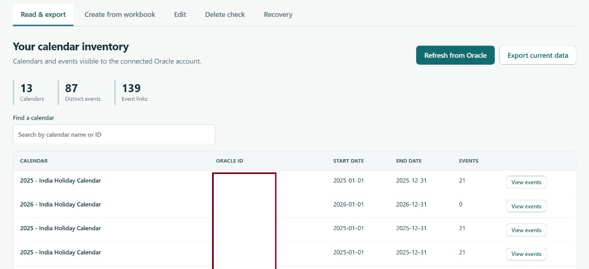

# K–12 Calendar Launcher | Oracle HCM

**Review which school calendars should receive each event before creating records in Oracle HCM.**

A district can share a holiday across several employee calendars while assigning another event to only one. The launcher lets an operator review those choices in a workbook, inspect the proposed build, and check the result in Oracle.

**Example.** The supplied workbook defines three events and two calendars. Four marked cells request four links. A blank cell leaves existing links alone.

*Inventory view from the working launcher. Screenshot supplied and redacted by Jan Petreczko. Cropped for public release.*

**[Try the workbook offline](docs/run-locally.md)** · **[Open the sample](app/templates/Calendar_Build_Sample.xlsx)** · **[See the design](docs/design.md)** · **[View verification](evidence/verification.md)**

## What the app does

- Read and export the calendars and events visible to an authorized Oracle account.
- Validate an Excel workbook, preview its calendars and event links, then submit a reviewed build.
- Preview supported calendar corrections. Check the current record before applying an edit.
- Reconcile interrupted work from a local journal. Calendar deletion is disabled.

## Run it

Use Windows with Python 3.10 or newer. From the extracted folder, run **RUN-SELF-TEST.cmd**, then **START-CALENDAR-LAUNCHER.cmd**. The interface opens in the local browser. Live operations require an authorized Oracle HCM environment and account. The offline example requires neither.

## How it works

A Python service binds to the local computer. It reads workbook cells directly and serves the browser interface. The operator selects the Oracle environment. Separate state folders hold each environment’s journals and receipts. Runtime dependencies are included in the Python standard library.

## What the tests show

The public edition includes offline regression tests for workbook rules, environment selection, simulated Oracle operations and recovery. The verification page distinguishes those results from live tenant and Windows workstation checks.
